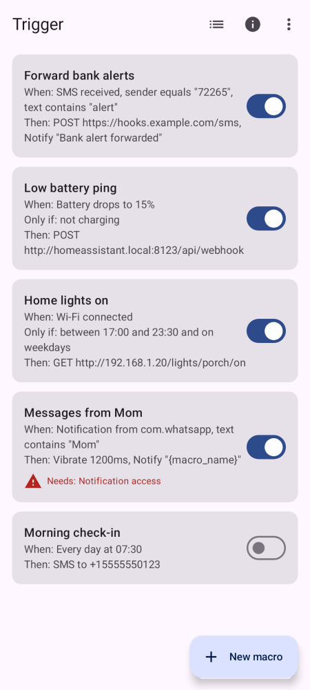
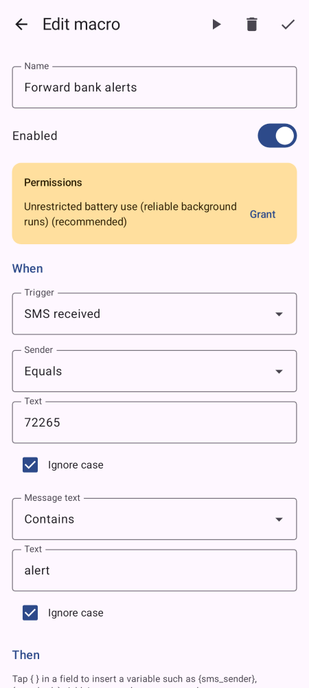
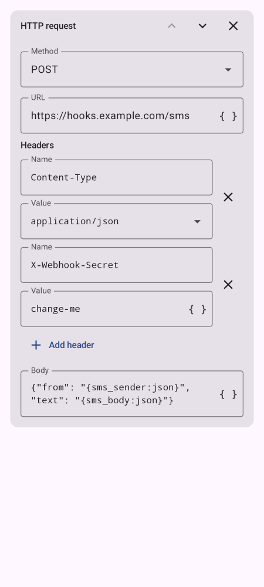
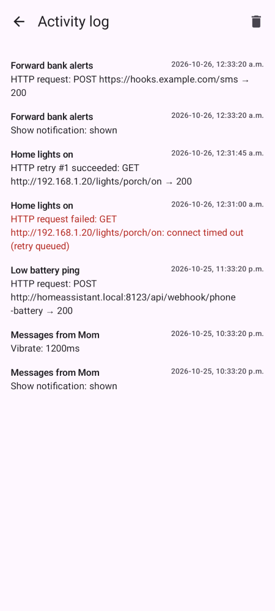
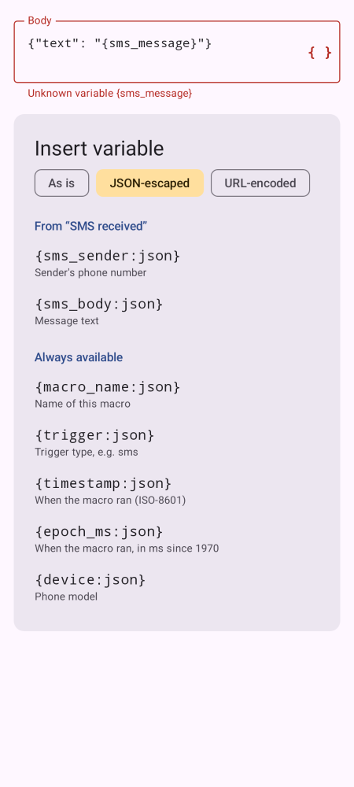
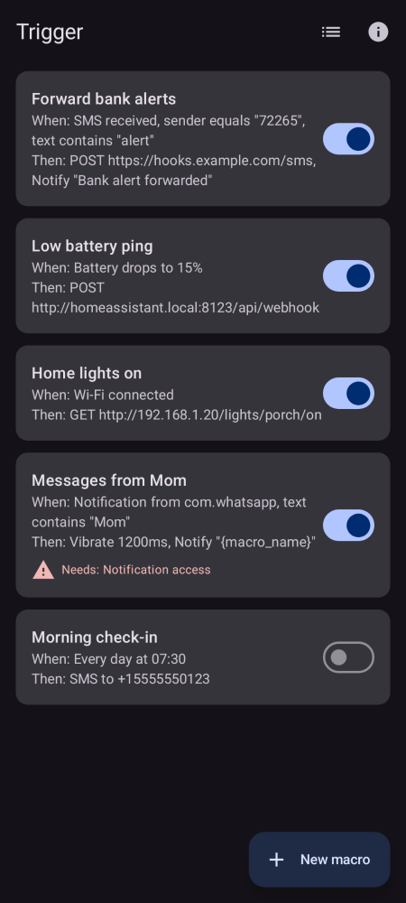
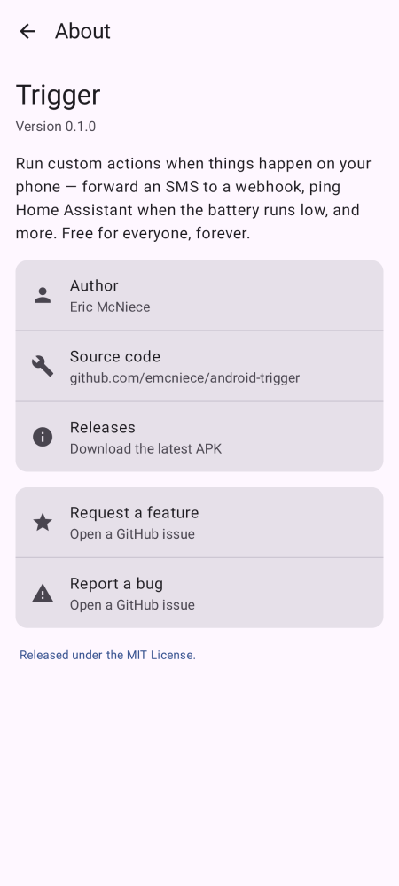

# Android Trigger

This native Android app allows for custom actions to run when Android OS events happen. For example: when an SMS message is received with a particular string, make an HTTP request.

This is a simplified version of the [MacroDroid](https://www.macrodroid.com/) app, and is free for everyone, forever.

**[Download the latest APK](https://github.com/emcniece/android-trigger/releases)** · **[Request a feature](https://github.com/emcniece/android-trigger/issues/new?labels=enhancement)** · **[Report a bug](https://github.com/emcniece/android-trigger/issues/new?labels=bug)**

## Screenshots

| Macros | Editor | HTTP request | Activity log |
|---|---|---|---|
|  |  |  |  |

| Variables | Dark theme | About |
|---|---|---|
|  |  |  |

*Screenshots are rendered from sample data with [Paparazzi](https://github.com/cashapp/paparazzi); regenerate them with `./gradlew updateScreenshots`.*

## Concepts

Like MacroDroid, the unit of automation is a **macro**: one **trigger** (with optional filters) and an ordered list of **actions**. MacroDroid offers 70+ triggers, 100+ actions and ~50 constraint types; Trigger deliberately covers the useful core.

### Triggers

| Trigger | Filters | Variables |
|---|---|---|
| SMS received | sender, message text | `sms_sender`, `sms_body` |
| Notification posted | app package, title/text | `notif_package`, `notif_title`, `notif_text` |
| Charger connected / disconnected | direction | `power_state` |
| Battery level | drops to / rises to N% | `battery_level`, `battery_previous` |
| Network connected / lost | any / Wi-Fi / mobile data | `network_state`, `network_type` |
| Device boot | – | – |
| Time of day | daily HH:MM | `time` |

Text filters support *contains*, *equals*, *starts with*, *ends with* and *regex*, optionally case-insensitive.

### Actions

- **HTTP request**: GET/POST/PUT/PATCH/DELETE with custom headers and body. Failed requests (network errors, 408/429/5xx) are retried with exponential backoff once the network is available.
- **Show notification**
- **Send SMS**
- **Vibrate**

### Variables

Any action field can use `{variable}` placeholders. Tap the **{ }** button on a field to pick one, and the editor flags placeholders that won't be filled in, such as a typo or a variable from a different trigger. Every macro gets `{macro_name}`, `{trigger}`, `{timestamp}` (ISO-8601), `{epoch_ms}` and `{device}`, plus the trigger's own variables above. Add `:json` to escape for a JSON string or `:url` to URL-encode, e.g.:

```json
{"from": "{sms_sender:json}", "text": "{sms_body:json}", "at": "{timestamp}"}
```

The ▶ button in the editor test-runs a macro with sample data, and every run is recorded in the activity log.

### Import and export

Use **⋮ → Export macros** to save all macros to a JSON file, and **⋮ → Import macros** to load them on another phone or after reinstalling. If an imported macro already exists, you can replace it or keep both. Exports include everything in your macros, including header values such as webhook secrets, so store them privately.

## Architecture

```
OS event ──► receiver / service ──► TriggerEvent ──► MacroEngine ──► ActionRunner
             SmsReceiver                              (match enabled     HTTP / notify / SMS / vibrate
             NotificationListener                      macros)           └─ HTTP failure ─► HttpRetryWorker (WorkManager)
             BootReceiver
             AlarmReceiver (AlarmManager)
             MonitorService (foreground; battery, charger, network)
```

- `model/`: serializable `Macro`, `Trigger`, `Action` sealed types
- `data/`: JSON-file persistence for macros and the activity log
- `engine/`: dispatch, templating, action execution, HTTP retry worker
- `triggers/`: Android entry points that turn OS events into `TriggerEvent`s
- `ui/`: Jetpack Compose screens (macro list, editor, log) and permission handling

The foreground `MonitorService` only runs while an enabled macro needs battery, charger or network events. Since Android 8, those broadcasts can't be received by manifest-declared receivers.

## Building

Requires JDK 17–21 and the Android SDK (platform 35).

```sh
./gradlew assembleDebug        # → app/build/outputs/apk/debug/app-debug.apk
./gradlew testDebugUnitTest
./gradlew updateScreenshots    # re-render docs/screenshots from ReadmeScreenshots.kt
adb install app/build/outputs/apk/debug/app-debug.apk
```

Debug builds install as a separate app, **Trigger Debug** (`com.emcniece.trigger.debug`), so they can sit alongside a release install. Both apps receive every SMS, so use different keywords for test macros. Debug builds can also simulate trigger events over adb without a real SMS or charger:

```sh
adb shell am broadcast -n com.emcniece.trigger.debug/com.emcniece.trigger.DebugEventReceiver \
  --es type sms --es sms_sender +15555550123 --es sms_body "'hello world'"
```

## Releases

Publishing a GitHub release tagged `vMAJOR.MINOR.PATCH` builds a signed APK and attaches it to the release, along with a SHA-256 checksum. Pull requests run unit tests, lint and a debug build. Dependabot patch and minor updates merge automatically once tests pass.

## Notes and limitations

- SMS and battery-optimization permissions are restricted on Google Play. This app is meant for sideloading or F-Droid.
- Cleartext `http://` is allowed so you can call LAN services such as Home Assistant.
- For reliable background runs, grant "Unrestricted battery use" when the editor asks for it. Some vendors (Xiaomi, Samsung, etc.) also need per-app auto-start settings.

## Roadmap

- Constraints (time window, day of week, charging, Wi-Fi SSID)
- More triggers: incoming call, headphones, Bluetooth device, geofence, app launched
- More actions: launch app/URL, set volume / DND, Tasker-style intents, run multiple macros
